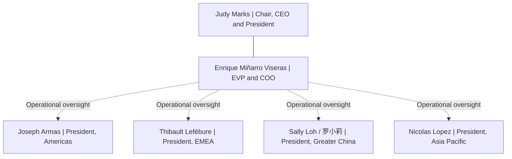

# Otis Global Leadership and Regional Operations

> Unofficial English translation of the Chinese research note, prepared November 14, 2026. Underlying research date: November 1, 2026. Roles have not been freshly verified during this translation. [Chinese note](../docs/zh-CN/otis-global-leadership.md).

Scope: Chair/CEO, COO and the heads of four geographical business segments; this is not a complete global management list.

The undirected line indicates a schematic management hierarchy. Dashed arrows indicate operational oversight, not individually verified direct reporting relationships. Greater China and Asia Pacific are separate geographical segments. The material does not establish whether Sally Loh reports directly to Enrique.

| Name / public LinkedIn profile | Position recorded in the source note |
| --- | --- |
| [Judy Marks](https://www.linkedin.com/in/judy-marks-otis/) | Chair, Chief Executive Officer and President |
| [Enrique Miñarro Viseras](https://www.linkedin.com/in/enrique-mi%C3%B1arro-viseras-6b58a563/) | Executive Vice President and Chief Operating Officer |
| [Joseph Armas](https://www.linkedin.com/in/armasj/) | President, Otis Americas |
| [Thibault Lefébure](https://www.linkedin.com/in/thibault-lef%C3%A9bure-66257a27/) | President, Europe, Middle East and Africa |
| [Sally Loh / 罗小莉](https://www.linkedin.com/in/sally-loh-3a946440/) | President, Otis Greater China |
| [Nicolas Lopez](https://www.linkedin.com/in/nicolas-lopez-215b3b9/) | President, Asia Pacific |

The note summarizes Enrique's official biography as responsibility for operational performance and execution, oversight of the four geographical segments' P&L businesses and global operations functions, including engineering, product management, supply chain, manufacturing, field excellence and spare parts. This supports an inference of Greater China operational oversight; it does not independently prove a direct reporting line or responsibility for a particular historical incident.

## Sources

- [Otis leadership directory](https://www.otis.com/en/us/our-company/our-leadership)
- [Enrique biography](https://www.otis.com/en/us/our-company/our-leadership/enrique-minarro-viseras)
- [Sally biography](https://www.otis.com/en/us/our-company/our-leadership/sally-loh)
- [Thibault biography](https://www.otis.com/en/us/our-company/our-leadership/thibault-lefebure)
- LinkedIn profiles above.
- [GitHub Mermaid documentation](https://docs.github.com/en/get-started/writing-on-github/working-with-advanced-formatting/creating-diagrams).

Appointments can change. This historical note does not imply that current leaders participated in the historical cases.
