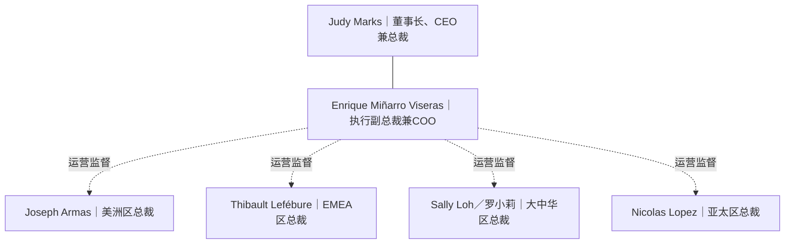

# Otis 全球领导层与区域运营架构

整理日期：2026-11-01

范围：董事长兼 CEO、COO 及四个地理业务分区负责人；不是完整的全球管理层名单。

## 组织架构示意图

说明：

- Judy 与 Enrique 之间的无箭头连线仅表示管理层级示意。
- 虚线表示 COO 对四个地理业务分区的运营监督职责，不表示逐一确认了各区域总裁的直接汇报关系。
- 大中华区与亚太区是并列的业务分区。
- 公开资料尚不足以确认 Sally Loh 当前是否直接向 Enrique 汇报，不能将运营监督等同于直接汇报。

## 姓名、职务与 LinkedIn

图内保留姓名和职务；可点击的 LinkedIn 链接集中列在下表，便于 GitHub Markdown 阅读。

| 姓名（LinkedIn） | 英文职务 | 中文职务／业务范围 |
|---|---|---|
| [Judy Marks](https://www.linkedin.com/in/judy-marks-otis/) | Chair, Chief Executive Officer and President | 全球董事长、首席执行官兼总裁 |
| [Enrique Miñarro Viseras](https://www.linkedin.com/in/enrique-mi%C3%B1arro-viseras-6b58a563/) | Executive Vice President & Chief Operating Officer | 全球执行副总裁兼首席运营官 |
| [Joseph Armas](https://www.linkedin.com/in/armasj/) | President, Otis Americas | 美洲区总裁 |
| [Thibault Lefébure](https://www.linkedin.com/in/thibault-lef%C3%A9bure-66257a27/) | President, Europe, Middle East & Africa (EMEA) | 欧洲、中东及非洲区总裁 |
| [Sally Loh／罗小莉](https://www.linkedin.com/in/sally-loh-3a946440/) | President, Otis Greater China | 大中华区总裁 |
| [Nicolas Lopez](https://www.linkedin.com/in/nicolas-lopez-215b3b9/) | President, Asia Pacific (APAC) | 亚太区总裁 |

## COO 的公开职责

奥的斯官方简介明确，Enrique 对全公司的运营表现与执行负责，监督四个地理业务分区的损益业务及全球运营职能，包括工程、产品管理、供应链、制造、现场卓越运营及备件。其职责涉及安全、质量和客户体验。

这支持“大中华区在其运营监督范围内”的判断，但不单独证明 Sally 的直接汇报线。

## 参考来源

1. [Otis 全球领导层名单](https://www.otis.com/en/us/our-company/our-leadership)
2. [Enrique Miñarro Viseras 官方简介](https://www.otis.com/en/us/our-company/our-leadership/enrique-minarro-viseras)
3. [Sally Loh 官方简介](https://www.otis.com/en/us/our-company/our-leadership/sally-loh)
4. [Thibault Lefébure 官方简介](https://www.otis.com/en/us/our-company/our-leadership/thibault-lefebure)
5. LinkedIn 个人公开主页：见上表。
6. [GitHub 官方 Mermaid 图表说明](https://docs.github.com/en/get-started/writing-on-github/working-with-advanced-formatting/creating-diagrams)

GitHub 支持在 Markdown 文件中渲染标记为 mermaid 的代码块。人员职务可能随组织调整而变化，引用时应核对官方现行名单。

